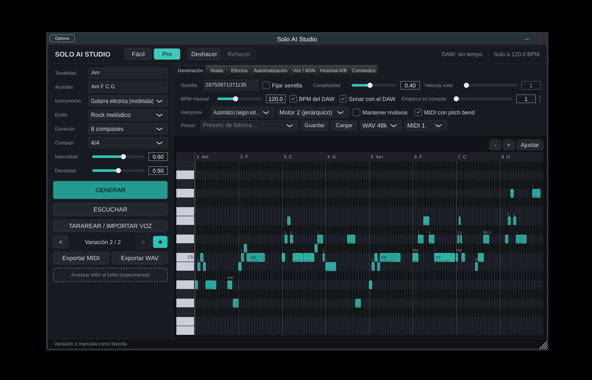

# Solo AI Studio

Plugin VST3 (JUCE + CMake, C++17) que compone solos instrumentales sobre una progresión de acordes,
los reproduce con sonidos integrados, permite editarlos en un piano roll y exportarlos como MIDI estándar y WAV.
Funciona sin conexión. Proyecto independiente de Spatial Echo Studio y AI Choir Studio.

> Estado: v2 en desarrollo (rama `claude/solo-ai-studio-avanzado`). **No validado todavía en FL Studio** ni con
> voces humanas reales. Ver [docs/STATUS.md](docs/STATUS.md).



## Estructura

```
core/            Núcleo musical sin dependencias (probado por separado)
  MusicTheory    escalas, acordes, progresiones, registros
  SoloComposer   compositor algorítmico por motivos y frases (semillas reproducibles)
  Sequence       secuencia MIDI canónica + historial de variaciones
  MidiFile       exportación/lectura Standard MIDI File (tipo 0 y 1)
  InstrumentEngine  síntesis integrada (guitarra pluck, flauta, synth lead)
  Playback       transporte del host, reproductor con precisión de muestra, intercambio lock-free
  AudioRenderer  render WAV offline con el mismo código que la reproducción en tiempo real
  StateManager   estado versionado v2 (lee v1), presets, deshacer/rehacer
  ComposerV2     compositor jerárquico (motor 2); LegacyComposer = motor 1 (S0–S2)
  Performer      intérprete: articulaciones según perfil e instrumento
  Effects        10 etapas de efectos, 8 presets, automatización
  SoloEngine     motor de audio único (tiempo real y exportación)
  VoiceAnalysis  WAV → notas (Hum-to-Solo), corrección vocal
  CreativeDNA    ADN musical y solos derivados
  Project        ProjectController: todas las operaciones con deshacer
  Commands       dirección por texto en español (preparada para voz)
  Analysis       métricas objetivas y sonoridad (LUFS)
plugin/          Plugin JUCE: procesador, editor (modo Fácil + pestañas Pro), piano roll
tests/           Pruebas unitarias del núcleo + host de prueba que carga el .vst3
tools/solo_cli   generate, demos (A/B), hum, synthvoice, bench, calibrate, command
examples/        MIDI de ejemplo (incluye Am–F–C–G a 146 BPM)
docs/            Instalación, arquitectura, estado, licencias, hoja de ruta
```

## Compilar

Windows (Visual Studio 2022 + CMake + Git):

```powershell
.\scripts\build.ps1            # compila, pruebas, host de prueba
.\scripts\build.ps1 -Install   # además instala el VST3 (PowerShell como administrador)
```

Linux/macOS: `scripts/build.sh`. JUCE 8.0.15 se descarga automáticamente (o `JUCE_DIR=/ruta`).

El CI de GitHub Actions (`.github/workflows/build.yml`) compila el VST3 para Windows x64 y lo publica como artefacto.

Más detalles: [docs/INSTALL.md](docs/INSTALL.md) · [docs/ARCHITECTURE.md](docs/ARCHITECTURE.md) ·
[docs/MIDI.md](docs/MIDI.md) · [docs/LICENSES.md](docs/LICENSES.md) · [docs/ROADMAP.md](docs/ROADMAP.md)
